<p align="center">
  
</p>

<p align="center">
  <b>A black hole, a galaxy or a pulsar as your Mac's desktop, animated and pixel-dithered.</b><br>
  Lives in the menu bar. Renders at a third of screen resolution and stops when you can't see it.
</p>

<p align="center">
  
</p>

Deep Field draws real physics (light bent around a black hole, a wormhole's throat, density-wave
spiral arms, a pulsar's lighthouse beams) and then renders it the way an old screen would: a
chunky pixel grid, a handful of color levels, and ordered Bayer dithering. Every scene moves, and
now and then something happens in the sky.

Requires macOS 14 or later.

## Scenes

<table>
  <tr>
    <td width="33%"><br><b>Black Hole</b></td>
    <td width="33%"><br><b>Star Meets Black Hole</b></td>
    <td width="33%"><br><b>Wormhole</b></td>
  </tr>
  <tr>
    <td><br><b>Binary Stars</b></td>
    <td><br><b>Trinary Stars</b></td>
    <td><br><b>Galaxy</b></td>
  </tr>
  <tr>
    <td><br><b>Pulsar</b></td>
    <td>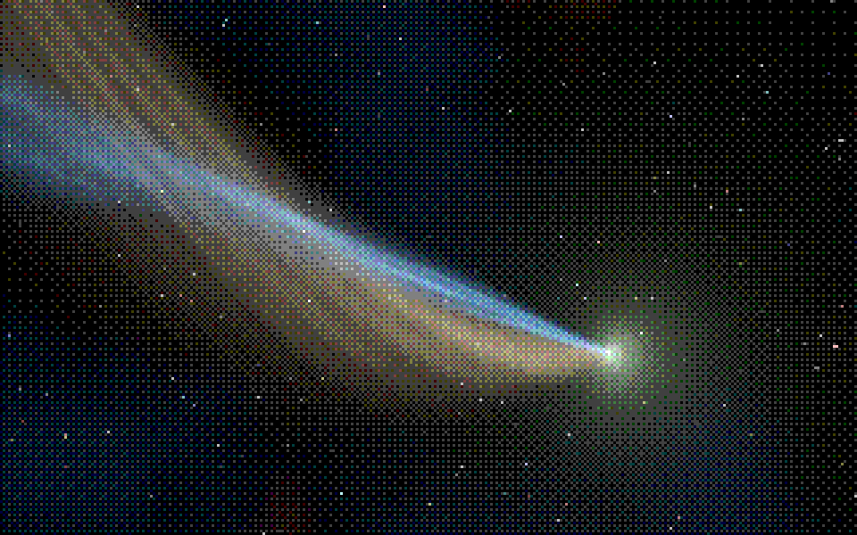<br><b>Comet</b></td>
    <td><br><b>Star Close-up</b></td>
  </tr>
  <tr>
    <td>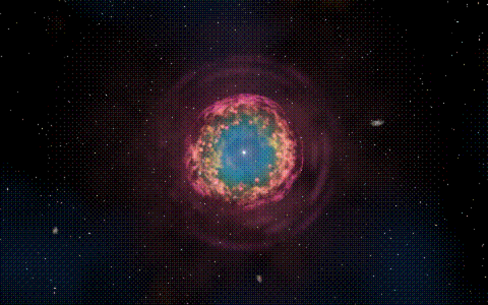<br><b>Planetary Nebula</b></td>
    <td><br><b>Ringed Planet</b></td>
    <td></td>
  </tr>
</table>

- **Black Hole**: a lensed accretion disk, redshifted orange on one side and blueshifted on the
  other, with a photon ring. Planets orbiting it get bent by its gravity as they pass behind.
- **Star Meets Black Hole**: a tidally stretched, egg-shaped star beside the hole is stripped
  into a glowing stream that feeds the accretion disk, with a bright shock where it hits the rim
  and optional jets. Star, stream and jets are all lensed.
- **Wormhole**: a crystal-ball throat showing another universe and its galaxy. The light of our
  own sky wraps around its edge. Now and then something falls in or comes out, a flare runs
  along the rim, or a supernova goes off on the far side.
- **Binary Stars** and **Trinary Stars**: real star types (red dwarf to blue giant, white dwarf,
  neutron star) with granulation, sunspots, coronas and eclipses. Planets are lit by every star.
- **Galaxy**: spiral, barred spiral, elliptical, irregular or ring, with a dust-laned disk, a
  bulge that sits partly in front of and partly behind the disk, and a halo of globular clusters.
  Stars orbit on a real rotation curve, with or without dark matter.
- **Pulsar**: a spinning neutron star with lighthouse beams, dipole field lines (or magnetar
  lobes), and a wind nebula with a torus and jets.
- **Comet**: a coma with rotating jets, a blue ion tail combed into streamers, and a curved dust
  tail. Now and then it has an outburst, or a chunk of ion tail breaks off and drifts away.
- **Star Close-up**: the limb of a star with granulation, sunspots, a chromosphere with
  spicules, coronal loops and prominences, plus occasional flares and coronal mass ejections.
- **Planetary Nebula**: the shell a dying star blew off, lit by the white dwarf left behind. A
  barrel of glowing gas shows as a ring: deep blue near the star, teal oxygen inside, a gold to
  crimson hydrogen rim with soft dense knots, and a faint halo of older shells drifting outward.
  Now and then the star flares and throws off a new shell.
- **Ringed Planet**: a banded gas giant whose jets shear the clouds past each other, with rings
  that turn (inner rings faster) and carry faint spokes. Rings and planet shadow each other; with
  the sun below the ring plane you see the rings' translucent unlit side and their striped shadow
  across the globe. Moons cross the disk and slip into the planet's shadow, and now and then a
  great white storm breaks out and wraps around a band. Ring style, bands, wind, moons and color
  presets are all adjustable.

## In motion

<table>
  <tr>
    <td width="50%"><br>Star meets black hole (3x speed)</td>
    <td width="50%"><br>Pulsar, one 3-second rotation</td>
  </tr>
  <tr>
    <td>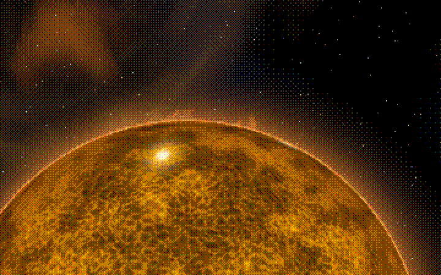<br>Star Close-up: a coronal mass ejection (14x)</td>
    <td><br>Comet: the ion tail breaks off (12x)</td>
  </tr>
  <tr>
    <td><br>Wormhole: something comes out (9x)</td>
    <td><br>Sky event: a supernova and its light echo (10x)</td>
  </tr>
</table>

Events are rare on purpose: a few per hour, at a frequency you choose per scene. The Customize
window has a **Show Me** button next to each one.

## Features

- **Nine scenes**, each with its own parameters, colors, events and camera.
- **Sky events in every scene**: background stars twinkle, a few pulsars blink, supernovae flare
  and leave light echoes, and comets drift past.
- **Palettes and color pickers**: six presets, or pick every color yourself.
- **Image controls**: exposure, contrast, saturation, highlight rolloff, black point, vignette
  and bloom, applied before dithering so the result is still dithered.
- **Pixel look**: pixel size, color levels and dither pattern (Bayer 8x8, Bayer 4x4, or none).
- **Orbiting planets** around the black hole, the wormhole and the star systems.
- **Lock screen still**: the lock and login screens show a still of your scene.
- **Phone wallpapers**: export the current scene as an iPhone still or Live Photo.
- **Light on the battery**: about 1/9 of the pixels shaded, 24 fps, paused when hidden.

## Install

Download **DeepField.dmg** from the [latest release](https://github.com/narrowstacks/deep-field/releases/latest),
open it, and drag Deep Field to Applications. It needs macOS 14 or later and runs on Apple
silicon and Intel Macs. The app is signed and notarized, and it updates itself: it checks
once a day, or choose **Check for Updates…** in its menu.

To start it with your Mac, use **Launch at Login** in its menu.

### Build from source

You need the Swift toolchain from Xcode or the Command Line Tools (`xcode-select --install`).

```bash
git clone https://github.com/narrowstacks/deep-field.git && cd deep-field
./build.sh && open build/DeepField.app
```

`build.sh` builds a release binary for this Mac and wraps it into `build/DeepField.app`
(ad-hoc signed). `UNIVERSAL=1` adds Intel, and `SIGNING_IDENTITY` signs it for distribution.

## Using it

Deep Field lives in the menu bar (a circle icon). The menu has **Pause Animation**,
**Customize…** (⌘,), **Use Scene on Lock Screen**, **Launch at Login** and **Quit**.

<p align="center">
  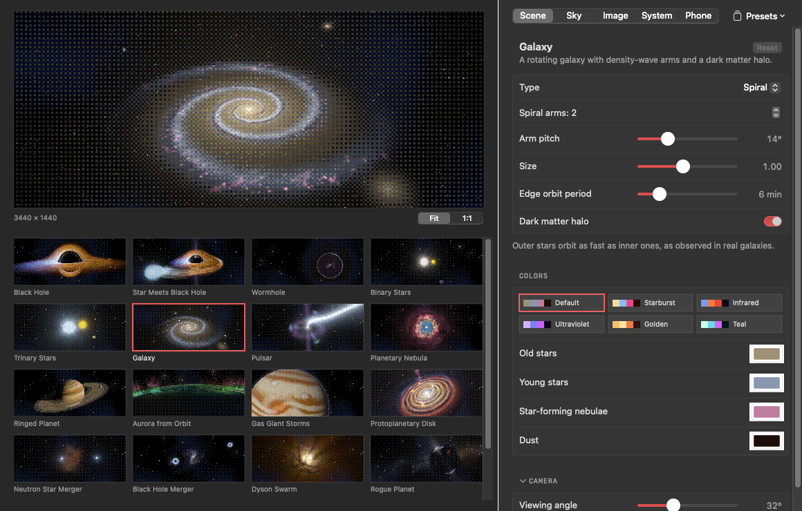
</p>

**Customize…** opens a dark two-column window. On the left, a live preview and a gallery of every
scene, each a small dithered still with your current settings; click one to switch. On the
right, five sections:

- **Scene**: the selected scene's parameters, framing (Star Close-up), colors (palette presets
  plus color pickers), its own events, planets and camera.
- **Sky**: the background sky, its colors, and the occasional events every scene shares.
- **Image**: tone, glow, pixel size, color levels and dither pattern.
- **System**: frame rate, the lock screen still, and reset.
- **Phone**: iPhone wallpaper export (the preview turns portrait).

The preview's **Fit / 1:1** switch shows the middle of the screen at the wallpaper's true pixel
size, to judge pixel size, levels and dither. Event frequencies come with **Show Me** buttons that
trigger an event right away. ⌘1 to ⌘5 pick a section, ⌘[ and ⌘] step through the scenes, and ⌘W
closes the window. Settings save automatically.

<table>
  <tr>
    <td width="50%">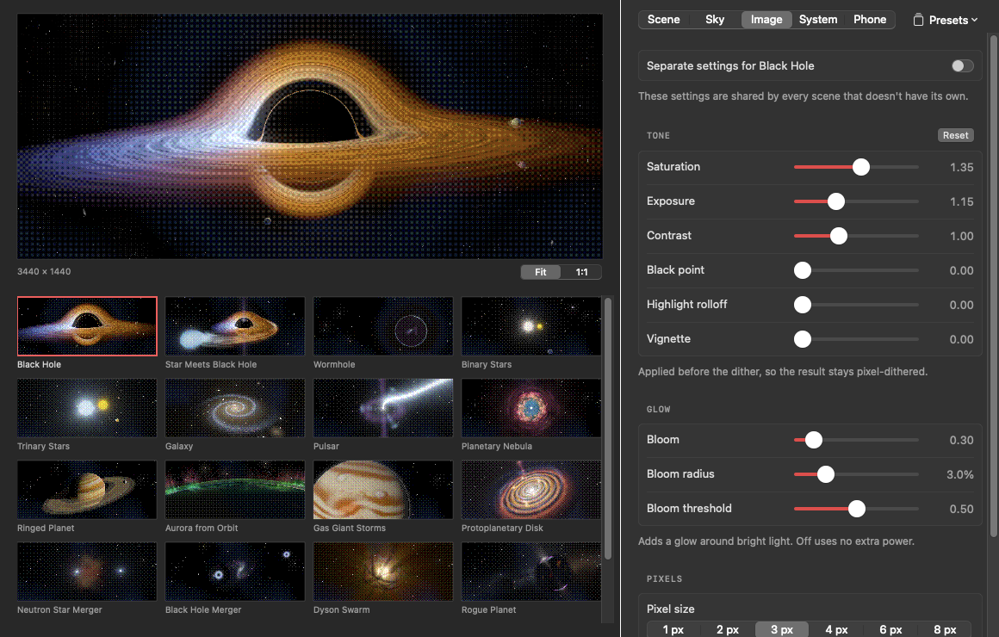<br>Image section</td>
    <td width="50%">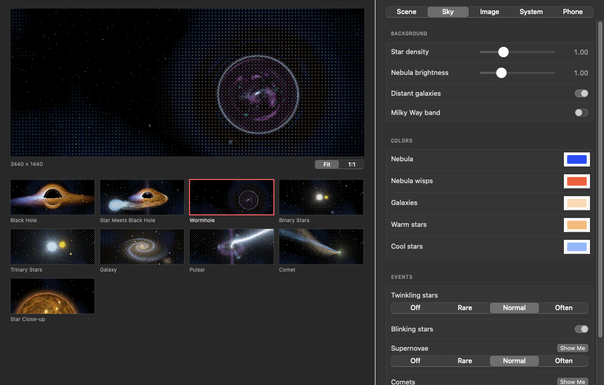<br>Sky section</td>
  </tr>
</table>

## Make it yours

**Palettes.** Six presets for the disk and galaxy colors, or pick each color yourself.


**Galaxy types.** Spiral, barred spiral, elliptical, irregular and ring, at any viewing angle.

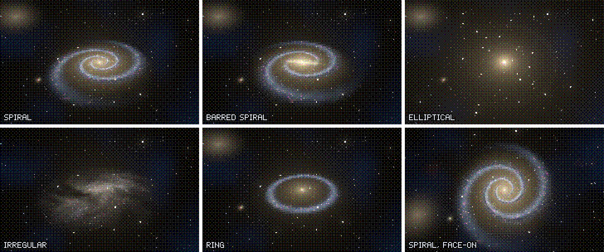

<p align="center">
  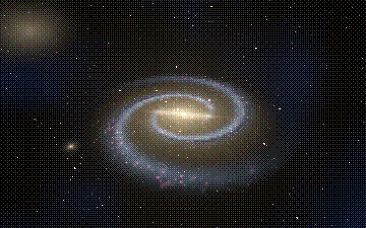<br>
  A barred spiral rotating (24x)
</p>

**Pulsar.** Field lines or magnetar lobes, either beam or both, and an optional dust ring.

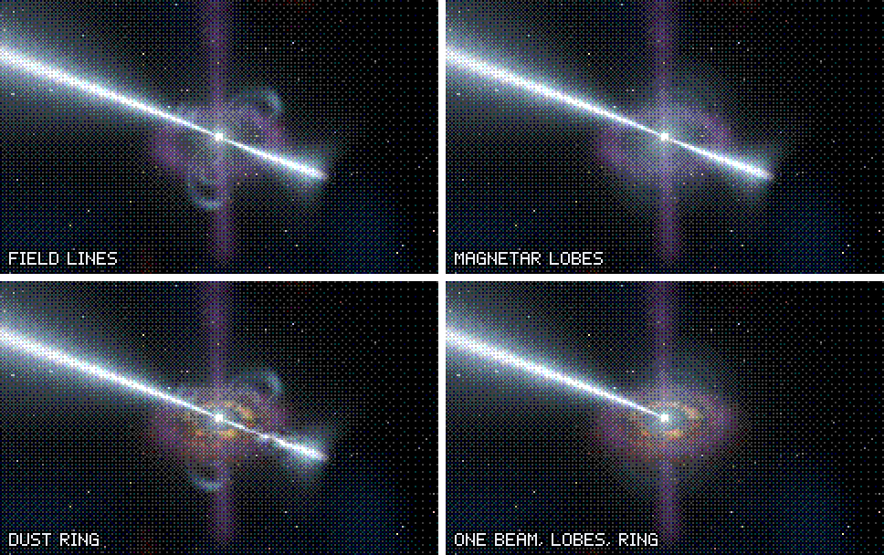

**Star Close-up zoom.** From the whole disk down to granulation along the limb.

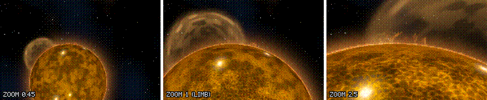

**Image controls.** The tone and glow controls (exposure, contrast, saturation, highlight
rolloff, black point, vignette and bloom) work on the scene's light before it's tone mapped and
dithered, so the result always stays dithered, and they apply to the wallpaper, the lock screen
still and phone exports alike. Bloom is a bright pass and blur at a quarter of the shaded size;
at 0 those passes don't run at all.

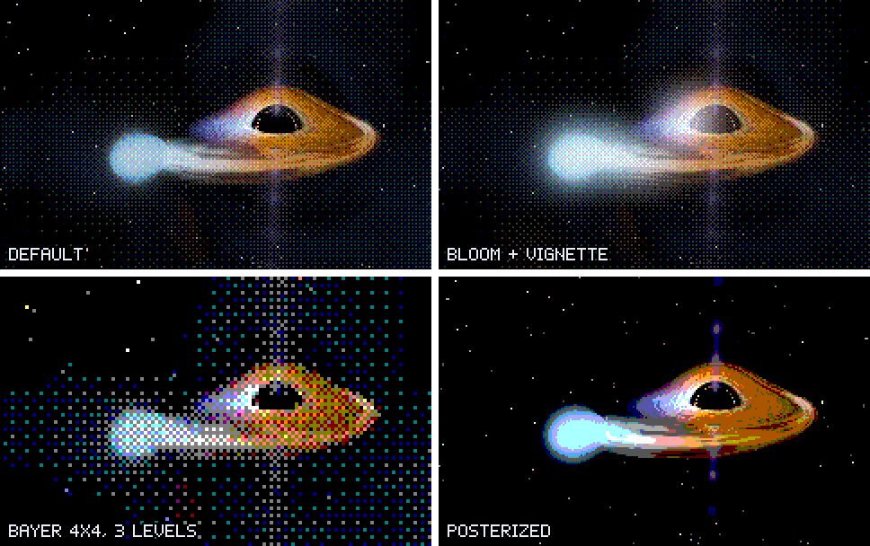

A picked color is what that part shows where it's typically lit: `Config/PickedColor.swift`
runs the tone map, saturation and gamma backwards from the pick, at each element's measured
typical brightness, and darker shades are built around it rather than by squaring it. The
background sky's colors and the galaxy's dust stay tints.

## Galaxy rotation and dark matter


Each star orbits at its own angular speed, ω(r) = v(r) / r, taken from a rotation curve:

- **With a dark matter halo** (the default), v(r) rises and then stays flat out to the edge, as
  observed in real galaxies.
- **Visible mass only** (toggle off), v(r) peaks near the center and falls off like v ∝ 1/√r. The
  outer disk visibly lags, which is what we'd expect without dark matter, and it isn't what we
  observe.

Spiral arms and bars are density waves that rotate rigidly at one pattern speed while stars
drift through them, so the arms don't wind up. Across an arm you see the order density-wave
theory predicts: dust lane on the inside edge, then pink star-forming regions, then young blue
stars. Dwarf irregulars turn almost like a solid body, matching their rising rotation curves.

## Phone wallpapers

<p align="center">
  
</p>

The **Phone** section of the Customize window turns the current scene into an iPhone wallpaper.
Pick a model (or a custom size) and it recomposes the scene for a tall frame, with the subject
below the Lock Screen clock; zoom and subject height adjust that, and a clock overlay shows where
the time will sit. It's dithered with the wallpaper's look (cells a notch larger than on the
desktop, or a size you pick) or smooth.

<p align="center">
  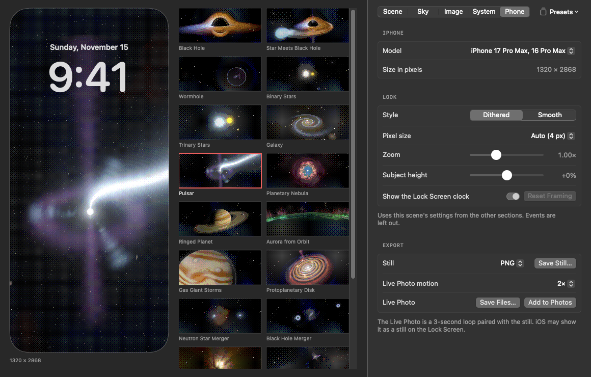
</p>

- **Still**: PNG or HEIC.
- **Live Photo**: a 3-second loop with events off and planets and star orbits held still, at 2x
  the wallpaper's speed by default so the motion shows. The pulsar's loop is a whole number of
  turns; elsewhere the last second dissolves, cell by cell along a Bayer threshold, into the
  frames before the start, so it loops without a jump. It's saved as a HEIC still plus a HEVC
  QuickTime movie that share a content identifier (the still's Apple maker note key 17, the
  movie's `com.apple.quicktime.content.identifier`, and a `still-image-time` metadata track at
  the middle frame). **Save Files…** writes the pair to a folder (AirDrop both together), and
  **Add to Photos** adds it to the Photos library as one Live Photo (asks for permission to add
  to Photos the first time), which reaches the iPhone through iCloud Photos.

What to expect on the iPhone: the Live Photo plays in Photos when you press and hold it. iOS 17
and later can play a Live Photo wallpaper on the Lock Screen, but they often refuse ones that
weren't taken with the Camera ("Motion not available"). Apple says the requirements are
undocumented, so there it's usually a still wallpaper.

## Lock screen

macOS shows the desktop picture, not the wallpaper window, on the lock and login screens. Turn on
**Use Scene on Lock Screen** (menu bar or the System section) and Deep Field keeps a still of the
current scene as each screen's desktop picture, dithered or smooth, so those screens match. It
re-renders when the scene's look or your displays change, leaves alone a screen whose picture
you've changed since, and puts your original pictures back when you turn it off. Quitting the
app leaves the still in place.

## Performance and battery

- **Rays are traced once.** The camera never moves, so each pixel's light path never changes. A
  compute pass traces every ray at startup (about 25 ms for the black hole) through
  Schwarzschild spacetime, an Ellis wormhole, or flat space. It stores where each ray hits the
  disk, where it crosses the planets' orbits, and which patch of sky it ends up seeing. A second
  pass measures how much sky each pixel covers and filters detail to match, so heavily lensed
  regions don't shimmer. Each frame only reads those lookups and animates on top of them, and
  lensing of planets, supernovae and comets comes for free.
- **Only the lookups a scene needs.** Each scene allocates just the bake textures it reads, in
  the smallest formats that hold its precision, and reuses them across re-bakes: about 8 MB per
  screen for flat-space scenes, up to about 44 MB for the black hole with planets.
- **Low resolution on purpose.** It renders at 1/3 of screen resolution by default and the
  compositor scales it up with nearest-neighbor filtering, so the GPU shades about 1/9 of the
  pixels.
- **Low frame rate.** 24 fps by default, capped at 12 in Low Power Mode and at 8 under thermal
  pressure.
- **Stops when nobody can see it.** The display link pauses when the wallpaper window is fully
  covered (`NSWindow.occlusionState`), when the displays sleep, and when you switch users.
- **Events are scheduled on the CPU** from a seeded hash per time slot, so there is no
  simulation state.

`--benchmark` (below) prints the GPU time per frame for each scene on your machine.

## Development

### Code layout

Everything is in `Sources/DeepField`:

- `App/`: entry point, app delegate and menu bar, the per-screen wallpaper windows, runtime flags.
- `Config/`: the settings model (`WallpaperConfig`, whose Codable keys are the saved format),
  scene kinds and options, star types, palettes and presets, and `ConfigStore`.
- `Scenes/`: CPU-side scene state: camera, planets, star systems, galaxy kinematics, the event
  schedule, and per-frame parameters for the newer scenes (`SceneParams`, `TidalDisruption`).
- `Rendering/`: `Renderer` (pipelines, bake, frame encoding), `WallpaperView`, and `GPUTypes`
  (uniform layouts mirrored in the shaders).
- `Rendering/Shaders/`: the Metal source as Swift strings, one file per area, joined in order by
  `ShaderSource.full` and compiled at runtime, so the build needs no Metal toolchain.
- `UI/`: the SwiftUI Customize window, one file per section, plus the stage, gallery and theme.
- `Mobile/`: the phone wallpaper export (portrait still, Live Photo pair, Photos library).
- `Dev/`: the command line below (snapshot, benchmark, event list, UI capture).

A nebula scene (pillars, dark clouds, planetary nebulae, supernova remnants) is in the code but
hidden from the scene list for now; see `SceneKind.isListed`.

### Dev tools

<details>
<summary>Command line reference (snapshots, benchmark, events, phone export, UI capture)</summary>

```bash
.build/release/DeepField --snapshot out.png --time 444 [--size 3440x1440] [--scene wormhole] \
    [--preset Synthwave] [--config '{"galaxyType": "barred", "darkMatter": false}'] [--no-events] \
    [--demo 1:440]                                            # force event kind 1 to start at t=440 s
.build/release/DeepField --benchmark [--scene galaxy] [--size 3440x1440] [--frames 120]
.build/release/DeepField --list-events 60 --scene wormhole   # when events fire (seed 1)
.build/release/DeepField --mobile-export outdir [--device 17-pro-max|1179x2556] [--live] [--smooth] \
    [--phone-pixel 4] [--zoom 1.2] [--shift 0.05] [--speed 2] [--scene comet] [--defaults]
.build/release/DeepField --check-live still.HEIC movie.MOV   # pairing metadata, loads as a Live Photo?
build/DeepField.app/Contents/MacOS/DeepField --customize   # open the Customize window at launch
build/DeepField.app/Contents/MacOS/DeepField --check-picker outdir -captureTab 0   # drive the color wells, check the preview follows
build/DeepField.app/Contents/MacOS/DeepField --capture-ui out.png -captureTab N -captureScene name [--defaults]   # image of the window (N: 0 Scene, 1 Sky, 2 Image, 3 System, 4 Phone)
defaults write com.narrowstacks.DeepField debug -bool true     # log bake times, fps, pause/resume
```

`--defaults` starts from the default settings instead of your saved ones (for `--capture-ui`
too, which never saves or touches desktop pictures). `--mobile-export` always writes the
portrait still as `<name>.png` (deterministic); with `--live` it also writes the Live Photo
pair, prints its pairing metadata, checks that PhotoKit loads it as a Live Photo (without
touching the library), and writes `<name> preview.mp4`, the loop played three times.

Snapshots are deterministic, so comparing `md5` of a set of them before and after a change
shows whether the output moved. Event kind ids for `--demo` are listed in `Scenes/Events.swift`.

`--benchmark` renders every listed scene (or just `--scene`, hidden ones included) offscreen at
3440x1440 and the configured pixel size, and prints, per scene, the GPU time of a bake (ray trace
plus sky pass, mean of 3 after a warm-up) and the mean and max GPU time per frame over 120 frames
starting at t = 300 s (`--time`), from `MTLCommandBuffer` GPU timestamps. It also prints the CPU
time spent encoding each frame. `--config` and `--preset` apply as for snapshots.

</details>

### Releasing

The version lives in `VERSION`, and each release has a section in `CHANGELOG.md`. To ship:

1. Set `VERSION` (for example `0.2.0`), move the `Unreleased` notes into a `## [0.2.0]` section, and commit.
2. Tag and push: `git tag v0.2.0 && git push origin v0.2.0`.

The [Release workflow](.github/workflows/release.yml) then builds a universal app on the
self-hosted Mac runner, signs it with the Developer ID certificate, packages and notarizes the
DMG, signs a Sparkle appcast, and publishes both to a GitHub release. Installed copies pick up
the new version from `releases/latest/download/appcast.xml`. A tag with a suffix (`v0.2.0-beta.1`)
becomes a prerelease, which the update feed skips. [CI](.github/workflows/ci.yml) builds every
push and pull request on GitHub-hosted runners.

Secrets the release needs: `APPLE_DEVELOPER_ID_P12_B64` and `APPLE_DEVELOPER_ID_P12_PASSWORD`
(the Developer ID Application certificate), `APPLE_NOTARY_API_KEY_B64`, `APPLE_NOTARY_API_KEY_ID`
and `APPLE_NOTARY_API_ISSUER_ID` (an App Store Connect API key for notarization), and
`SPARKLE_ED_PRIVATE_KEY` (the update signing key; its public half is `SUPublicEDKey` in `build.sh`).

### App icon, logo and media

The icon lives in `Design/Icons/AppIcon.png` and `build.sh` turns it into `AppIcon.icns`. The
scripts that generated it and the other candidate icons are in `Design/Icons/` (see its README).

The wordmark, banner and every image and loop in this README are rendered by the app itself and
regenerated with one script (needs Python 3 with numpy and Pillow, and ffmpeg):

```bash
Design/Brand/make_media.sh
```

See [`Design/Brand/README.md`](Design/Brand/README.md) for what it makes and
[`docs/site-assets/README.md`](docs/site-assets/README.md) for the website kit (heroes, social
cards, favicons, gallery, MP4 loops, copy). Longer, higher quality videos belong on a release as
attachments rather than in the repo.
