<p align="center">
  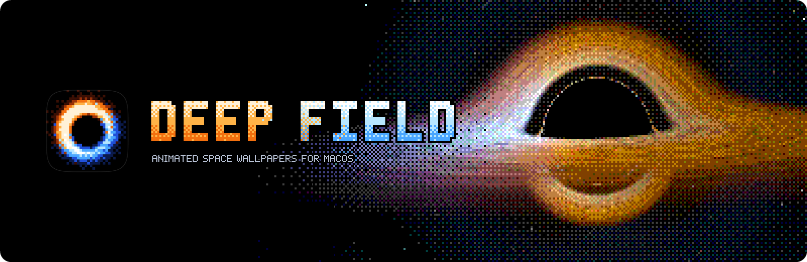
</p>

<p align="center">
  <b>Black holes, galaxies, auroras and ringed planets, moving on your Mac's desktop as dithered pixel art.</b><br>
  It lives in the menu bar and pauses whenever you can't see it.
</p>

<p align="center">
  
</p>

Each scene starts from real physics, like the way a black hole bends light or a galaxy's arms
turn, and is drawn the way an old screen would draw it: big pixels, a handful of colors, and
ordered dithering. Everything moves, and every so often something happens, like a comet
drifting past or a supernova going off in the background.

## Install

Download **DeepField.dmg** from the [latest release](https://github.com/narrowstacks/deep-field/releases/latest),
open it, and drag Deep Field to Applications. It runs on macOS 14 or later, on Apple silicon and
Intel. The app is signed and notarized and updates itself.

The first time you open it, a short guide lets you pick a scene and try a few looks on a large
preview. Your desktop doesn't change until you choose **Set as Wallpaper** at the end. After that
Deep Field lives in the menu bar, where you'll find **Customize…**, **Launch at Login** and the
guide again.

## Scenes

<table>
  <tr>
    <td width="33%">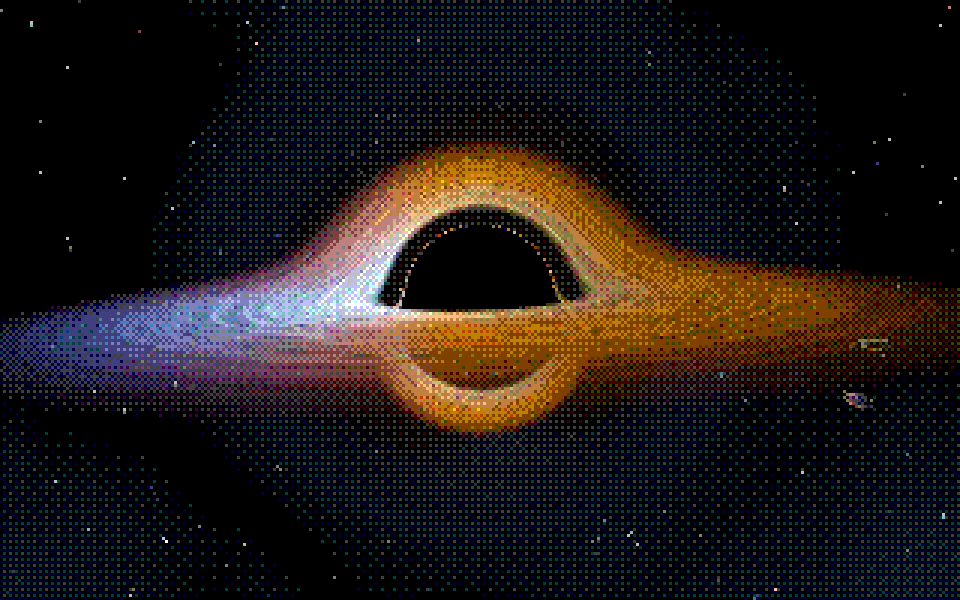<br><b>Black Hole</b><br><sub>A lensed accretion disk and photon ring. Planets bend as they pass behind.</sub></td>
    <td width="33%"><br><b>Star Meets Black Hole</b><br><sub>A star stretched by tides, feeding a glowing stream into the disk.</sub></td>
    <td width="33%">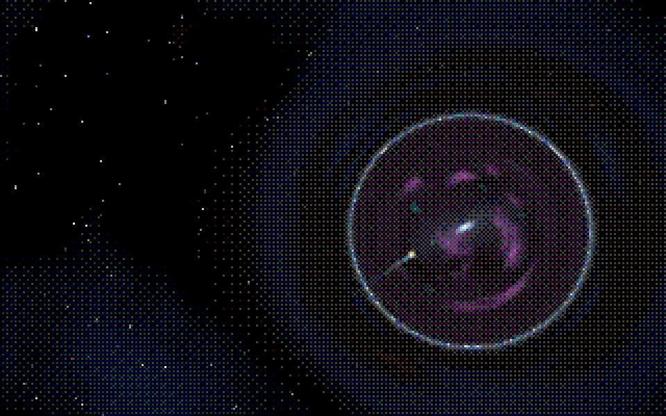<br><b>Wormhole</b><br><sub>A window into another universe, with our sky wrapped round its rim.</sub></td>
  </tr>
  <tr>
    <td>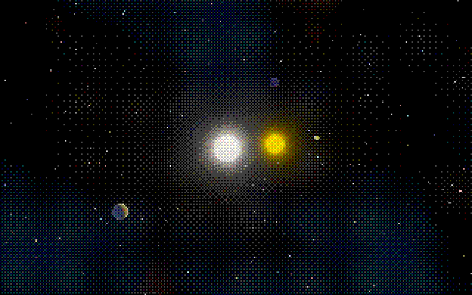<br><b>Binary Stars</b><br><sub>Two real star types in orbit, eclipsing each other.</sub></td>
    <td><br><b>Trinary Stars</b><br><sub>A close pair and a distant third, all lighting their planets.</sub></td>
    <td>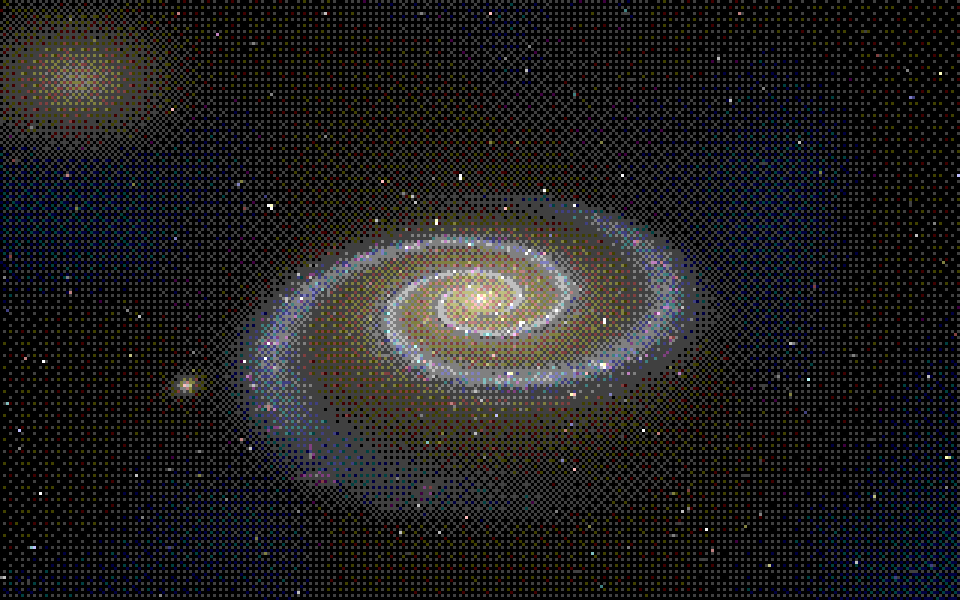<br><b>Galaxy</b><br><sub>Spiral, barred, elliptical, irregular or ring, turning like the real thing.</sub></td>
  </tr>
  <tr>
    <td><br><b>Pulsar</b><br><sub>A spinning neutron star sweeping its lighthouse beams.</sub></td>
    <td><br><b>Comet</b><br><sub>Jets from the nucleus, a blue ion tail and a curved dust tail.</sub></td>
    <td><br><b>Star Close-up</b><br><sub>The edge of a star, with loops, flares and eruptions.</sub></td>
  </tr>
  <tr>
    <td><br><b>Planetary Nebula</b><br><sub>The glowing shell a dying star threw off.</sub></td>
    <td>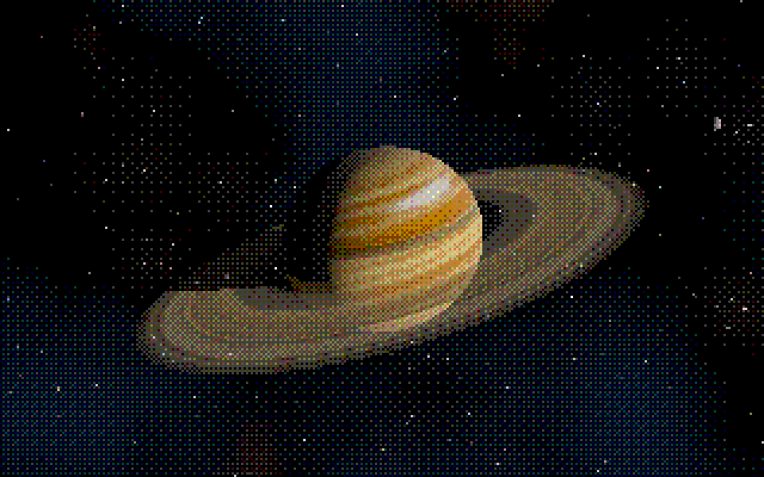<br><b>Ringed Planet</b><br><sub>Rings and planet shadowing each other, with moons passing.</sub></td>
    <td>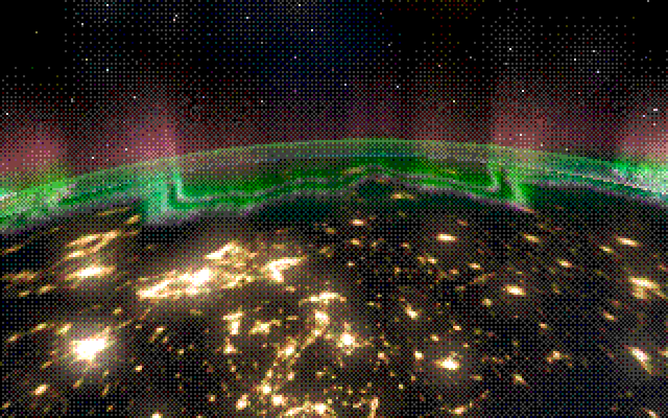<br><b>Aurora from Orbit</b><br><sub>Aurora curtains over Earth's night side, real city lights below.</sub></td>
  </tr>
  <tr>
    <td>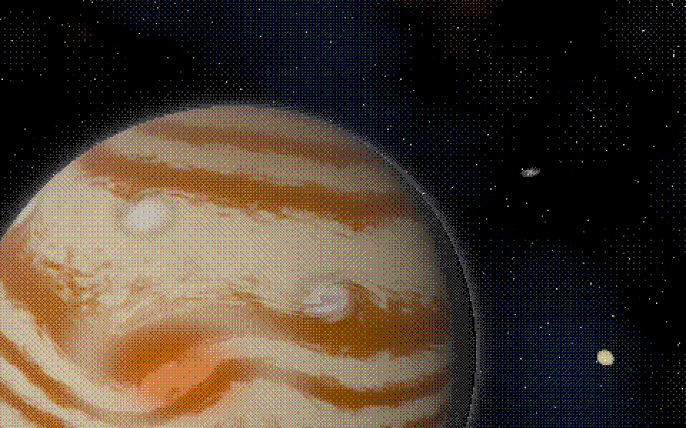<br><b>Gas Giant Storms</b><br><sub>Flowing cloud bands and spinning storms, up close.</sub></td>
    <td>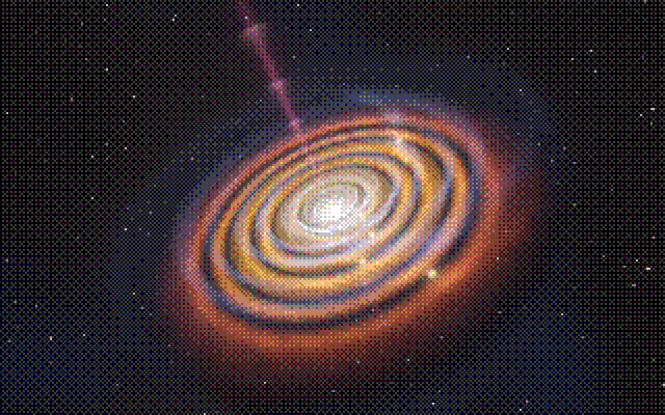<br><b>Protoplanetary Disk</b><br><sub>A young star in a ringed dusty disk, with planets clearing the gaps.</sub></td>
    <td>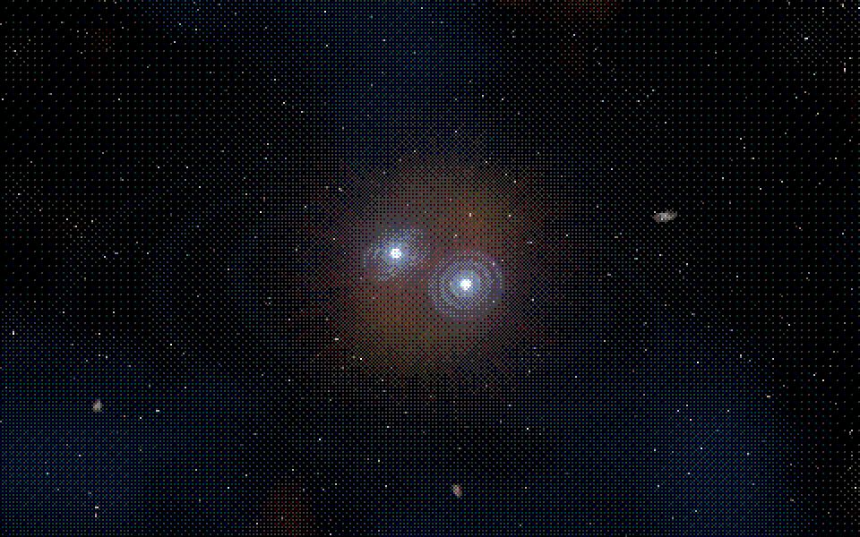<br><b>Neutron Star Merger</b><br><sub>Two neutron stars spiral together and merge in a kilonova, again and again.</sub></td>
  </tr>
  <tr>
    <td>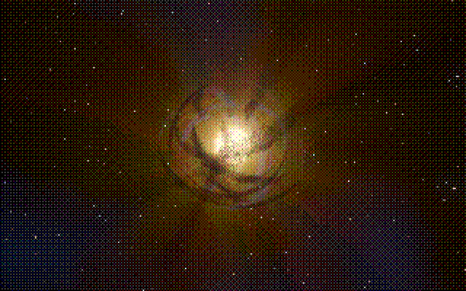<br><b>Dyson Swarm</b><br><sub>A star wrapped in crossing rings of glinting collector panels.</sub></td>
    <td>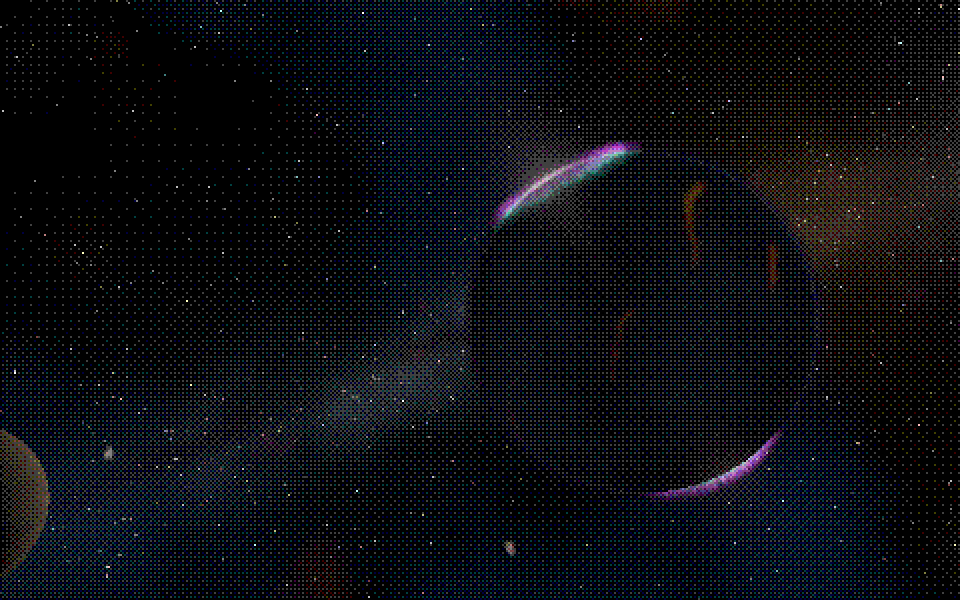<br><b>Rogue Planet</b><br><sub>A dark, sunless world drifting past the Milky Way, its poles aglow.</sub></td>
    <td>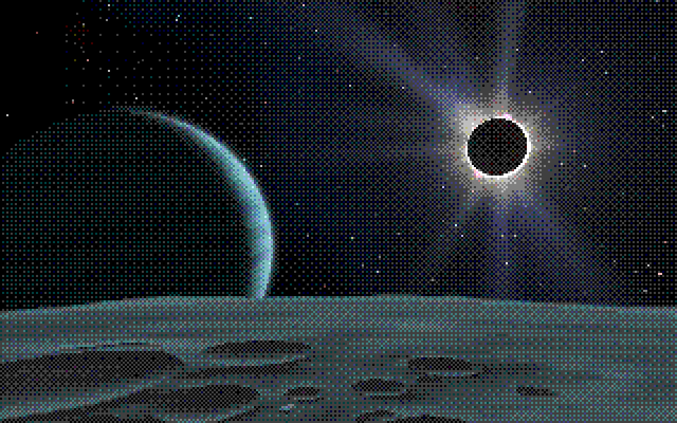<br><b>Eclipse</b><br><sub>A total eclipse from another world, with planets and skies you choose.</sub></td>
  </tr>
  <tr>
    <td>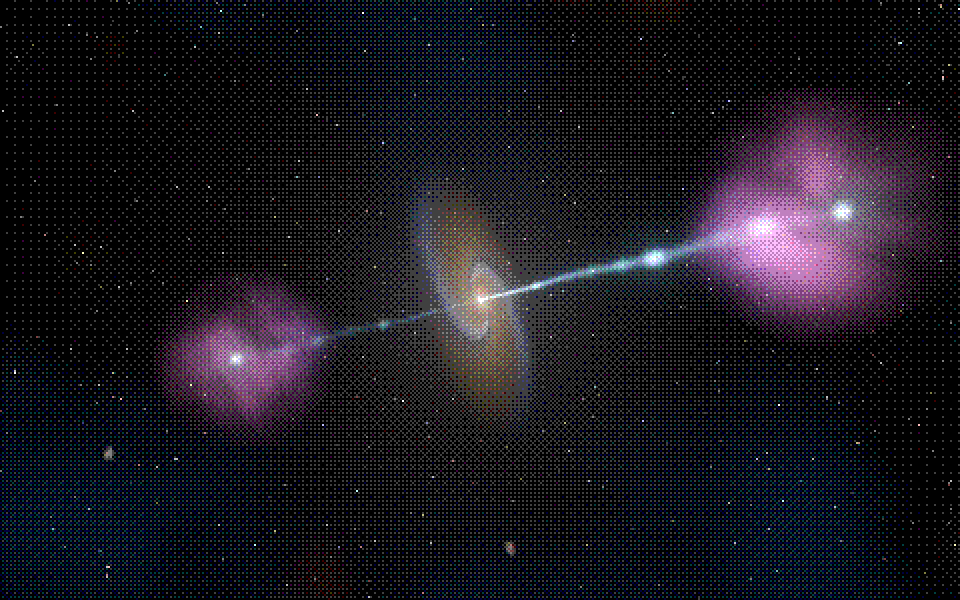<br><b>Quasar</b><br><sub>A galaxy's blazing core firing jets out to glowing radio lobes.</sub></td>
    <td>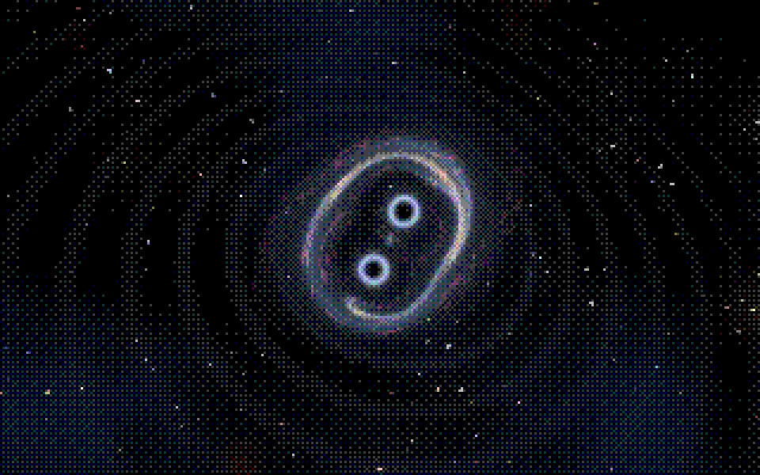<br><b>Black Hole Merger</b><br><sub>Two black holes spiral together, bending the starlight behind them, and merge.</sub></td>
    <td>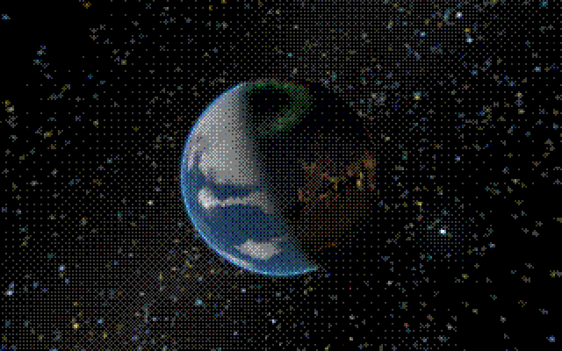<br><b>Live Earth</b><br><sub>Earth right now over a place you pick, with the real Moon, stars, clouds and aurora forecast.</sub></td>
  </tr>
</table>

## In motion

<table>
  <tr>
    <td width="50%">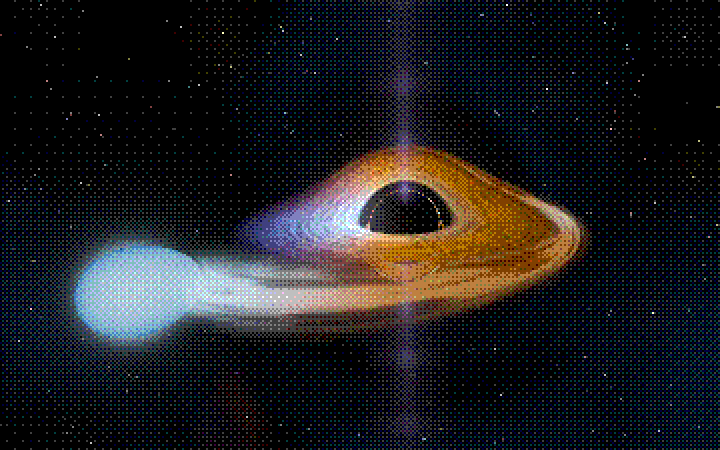<br>Star meets black hole (3x speed)</td>
    <td width="50%"><br>Pulsar, one 3-second rotation</td>
  </tr>
  <tr>
    <td><br>Star Close-up: a coronal mass ejection (14x)</td>
    <td><br>Comet: the ion tail breaks off (12x)</td>
  </tr>
  <tr>
    <td><br>Wormhole: something comes out (9x)</td>
    <td>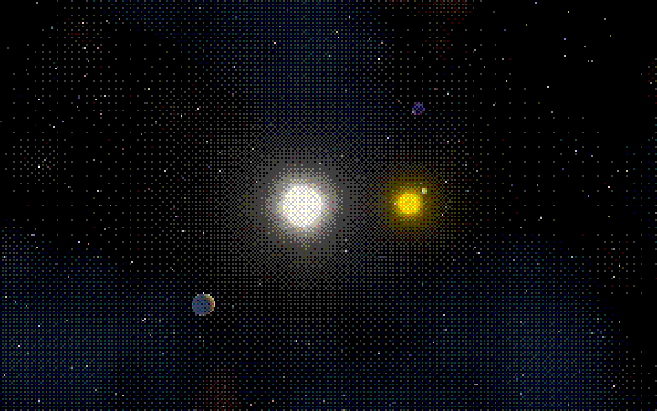<br>A supernova and its light echo (10x)</td>
  </tr>
</table>

Events like these are rare on purpose, a few an hour. You set how often each one happens, and
the **Show Me** button next to it plays one right away.

## Make it yours

Click the menu bar icon and choose **Customize…**. Pick a scene from the gallery, and the panel
beside the preview shows everything you can change for it: its shape and motion, its colors,
its events and the camera. The other sections cover the background sky, the image (exposure,
contrast, bloom and so on) and the pixel look (pixel size, number of colors, dither pattern).
Settings save as you go.

Found a look you like? Save it as a preset from the **Presets** menu in Customize, then switch
between your presets from the menu bar icon. Presets export as small `.deepfield` files you can
share, and anyone with Deep Field can import them.

A few more things you can change:

- **Reset** next to a scene's name puts that scene's settings and colors back to their defaults.
- **Separate settings for this scene** in the Image section gives a scene its own exposure, bloom
  and pixel look, so a bright scene and a dark one can each look their best.
- **Star field** in the Sky section rearranges the background stars, nebulae and galaxies. Type a
  number to come back to a sky you liked, or press **Randomize**.
- Twinkling stars have their own brightness and speed, next to how often they twinkle.

<p align="center">
  
</p>

Choose a palette preset, or pick every color yourself:


Change the look itself: add bloom or a vignette, use bigger pixels, or turn dithering off.


### Change scenes on a schedule

In the **Schedule** section of Customize, have Deep Field rotate through your presets and scenes
every few minutes or hours (in order or shuffled), or switch at set times on the days you pick,
like a calm scene for the workday and something brighter in the evening. Choose how each switch
looks: a dithered dissolve, a crossfade, a camera pan, the old scene drifting off into the
distance, a warp, a black hole sweeping across that bends one scene into the next, or a random
one each time. Turn the schedule on and off, or skip ahead, from the menu bar icon. A Focus
filter takes precedence while it's on.

### Focus modes and Shortcuts

Deep Field can change with your Focus. In **System Settings > Focus**, choose a Focus, add a
**Focus Filter**, pick Deep Field, and choose one of your presets or a scene. It switches when the
Focus turns on and goes back to how it was when the Focus ends. The same choices are actions in
the Shortcuts app (**Apply Deep Field Preset** and **Set Deep Field Scene**), for any automation
you like.

### Command line

Everything above also works from a terminal. Link the `deepfield` command onto your PATH once:

```bash
/Applications/DeepField.app/Contents/MacOS/DeepField install
```

Then change the wallpaper, its settings and presets, and render stills, videos and time-lapses:

```bash
deepfield scene galaxy galaxyType=barred --fade 4 --style warp   # switch, with a transition
deepfield set bloom=0.6 dither=blueNoise palette.core=#ffd27a     # tweak what's showing
deepfield keys                                                    # this scene's settings
deepfield preset apply "Late Night"; deepfield event supernova
deepfield render shot.png --size 5120x2880
deepfield render video loop.mp4 --duration 8 --loop
deepfield render timelapse earth.mp4 --scene liveEarth --speed 3600
```

Changes go to the running app and show at once; when it isn't running they're saved for its next
launch. `deepfield help` lists every command, and `deepfield completion zsh|bash|fish` prints
tab completion for your shell.

### A galaxy with and without dark matter

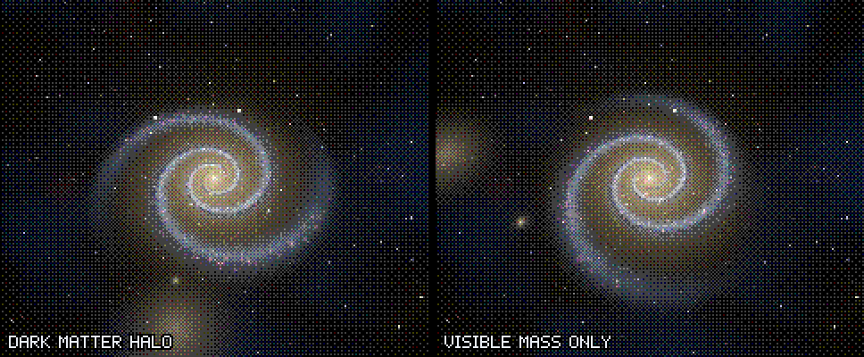

The Galaxy scene has a dark matter switch. With it on, the outer stars orbit about as fast as
the inner ones, which matches what astronomers measure. Turn it off and the outer disk falls
behind, which is what we'd expect if visible matter were all there is.

### Eclipses from other worlds

Stand on gray rock, ice, rust desert or cracked volcanic basalt, put a gas giant, a ringed giant
or a cratered moon in the sky, and give the world an atmosphere if you like.

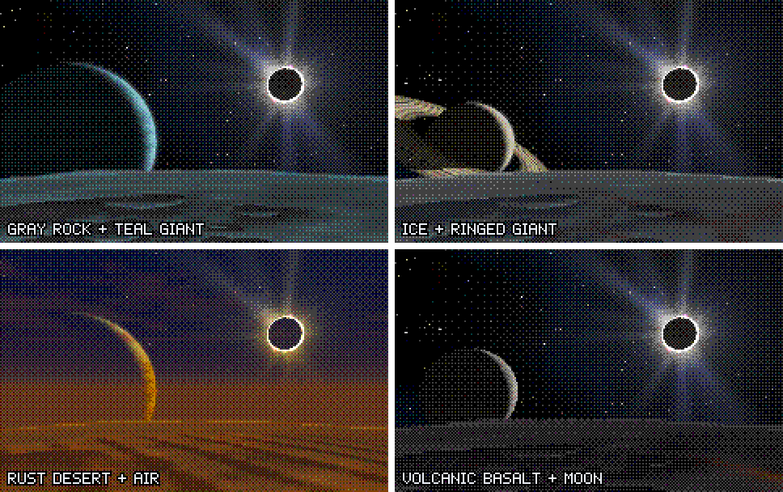

### Black hole mergers, as LIGO hears them

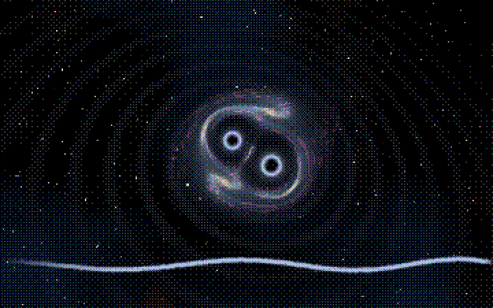

Gravitational waves carry off the pair's orbital energy, so the two black holes close in faster
and faster, bending the starlight behind them into arcs and a ring. Their shadows stretch toward
each other, join, and spin on as one lopsided hole that rings down into a sphere, slowed here so
you can watch it. The line along the bottom is the signal a detector would record: the rising
chirp, the merger and the ringdown.

Load a real detection, from GW150914 (the first ever heard) to GW231123 (the most massive), to
use its masses, spins and viewing angle. Then choose how big the black holes are, which sets
what surrounds them:

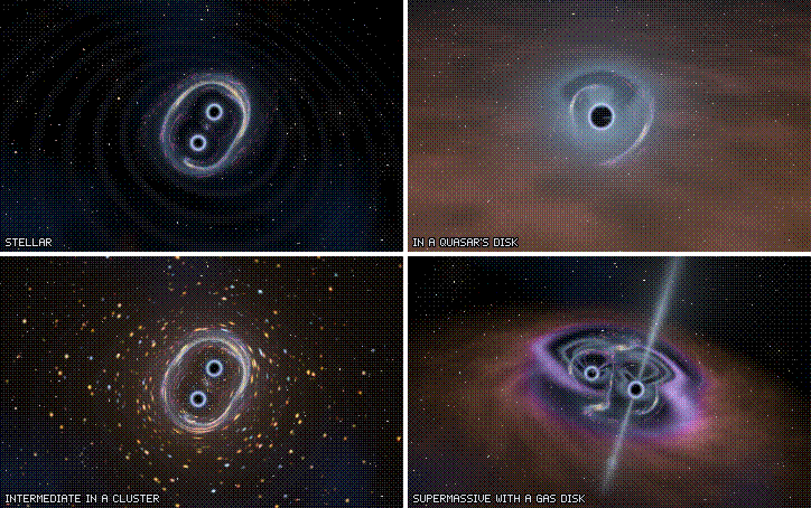

<table>
  <tr>
    <td width="50%">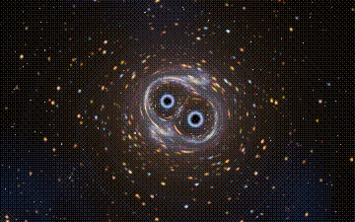<br>Intermediate black holes merging in a dense star cluster</td>
    <td width="50%">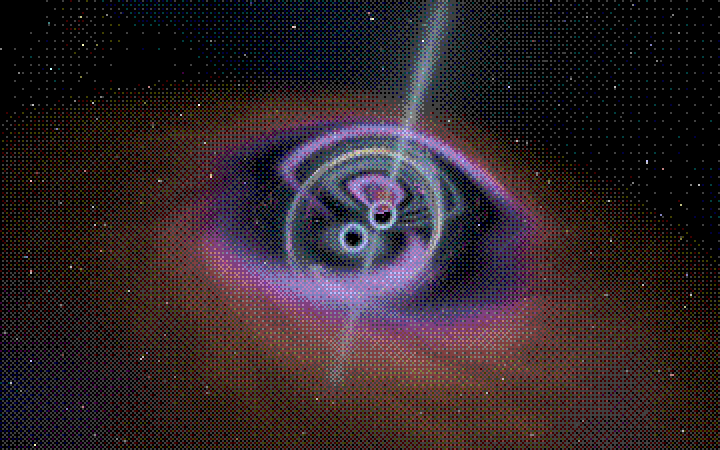<br>Supermassive black holes in the gas disk they've cleared</td>
  </tr>
</table>

## Phone and lock screen

The **Phone** section turns the current scene into an iPhone wallpaper, framed so the subject
sits below the Lock Screen clock. Save it as a still, or as a Live Photo that you can add
straight to Photos. iOS often won't animate Live Photos on the Lock Screen unless they came from
the Camera, so expect a still there.

<p align="center">
  
</p>

macOS shows a regular desktop picture on the lock and login screens. Turn on **Use Scene on Lock
Screen** and Deep Field sets a still of your scene there too, then puts your old pictures back
when you turn it off.

## Light on your battery

Deep Field draws at a third of your screen's resolution (so the GPU shades about one pixel in
nine) at 24 frames a second, and less in Low Power Mode. It stops entirely when the desktop is
covered, when the displays sleep, or when you switch users. Most scenes take under a millisecond
of GPU time per frame.

## Building from source and contributing

```bash
git clone https://github.com/narrowstacks/deep-field.git && cd deep-field
./build.sh && open build/DeepField.app
```

[`docs/DEVELOPMENT.md`](docs/DEVELOPMENT.md) covers the code layout, how the rendering works, the
command line tools for snapshots and benchmarks, and how releases are made.

Before your first pull request is merged, you'll be asked to sign the
[Contributor License Agreement](CLA.md) by posting a comment on the pull request. It lets the
maintainer keep Deep Field open source while also using contributions in other editions of the
app, such as versions for iPhone and Apple TV.

## License

Deep Field is free software under the [GNU General Public License v3.0](LICENSE). You can use,
change and share it, and anything you distribute that's built from it must be under the same
license, with its source. The license doesn't cover the name Deep Field, so please give forks
their own name.
