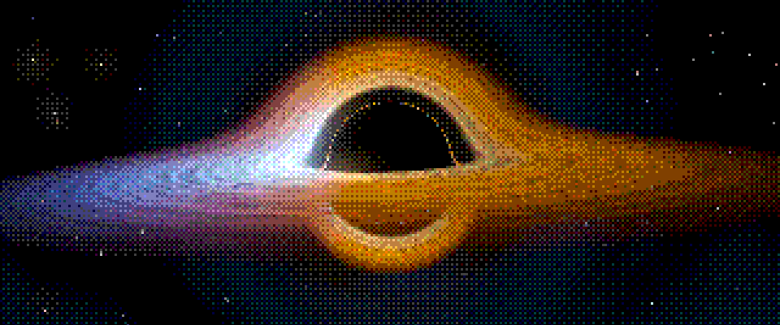
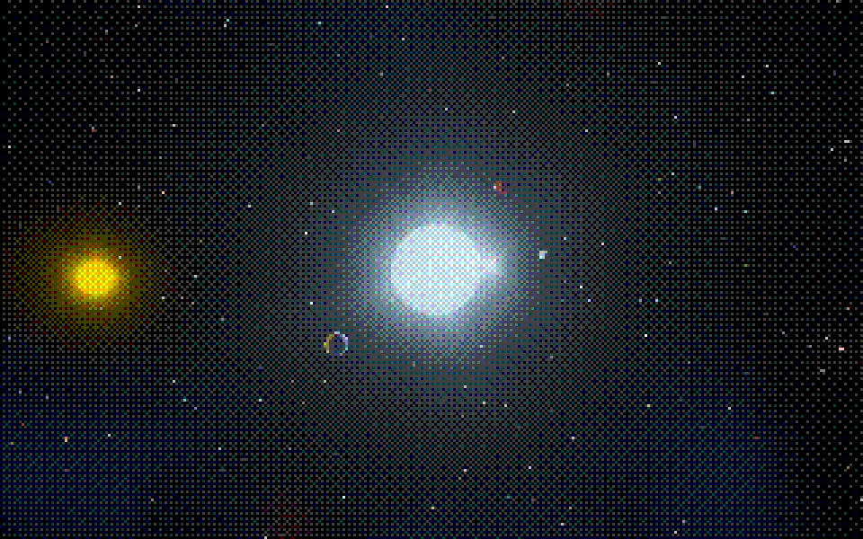
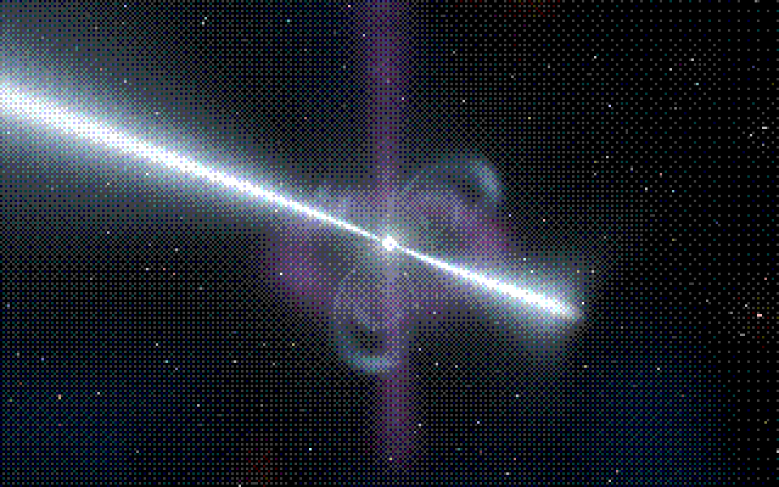
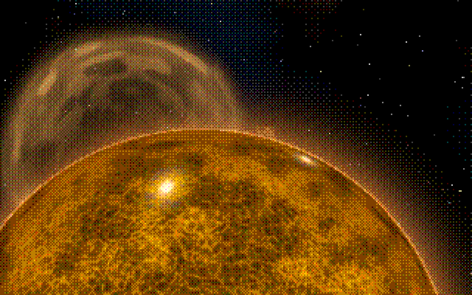
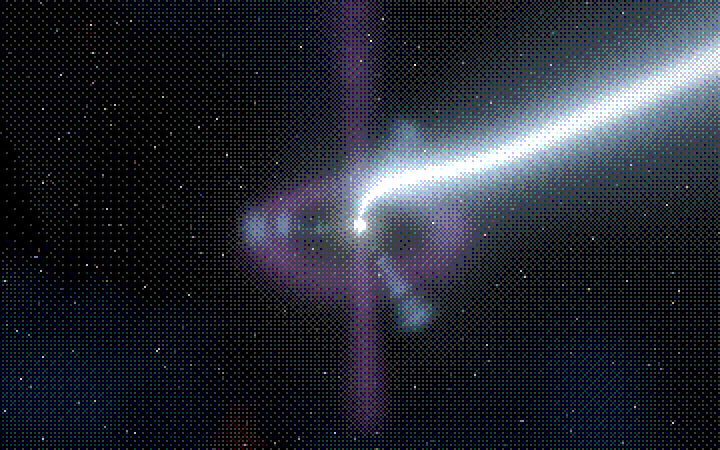
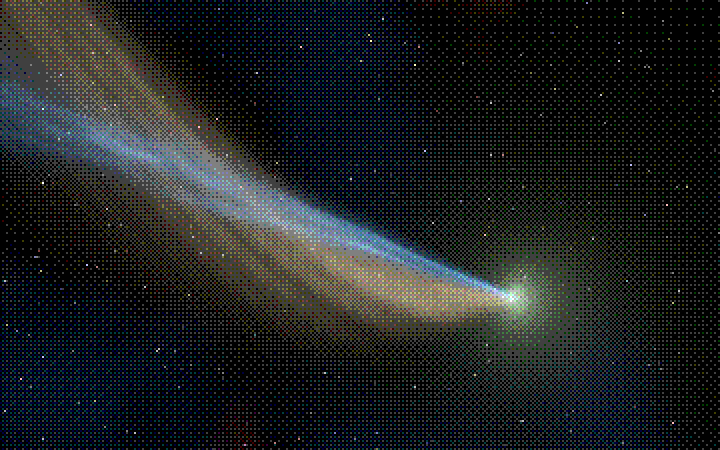
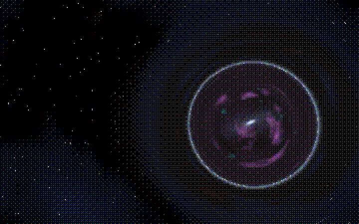
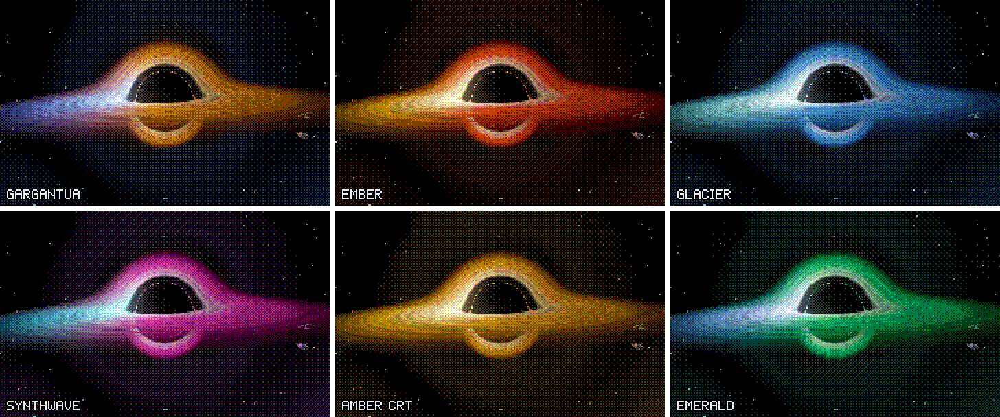
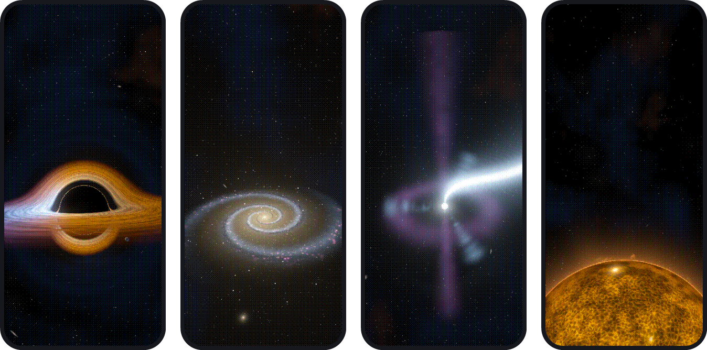

<p align="center">
  
</p>

<p align="center">
  <b>Black holes, galaxies, auroras and ringed planets, moving on your Mac's desktop as dithered pixel art.</b><br>
  It lives in the menu bar and pauses whenever you can't see it.
</p>

<p align="center">
  
</p>

Each scene starts from real physics, like the way a black hole bends light or a galaxy's arms
turn, and is drawn the way an old screen would draw it: big pixels, a handful of colors, and
ordered dithering. Everything moves, and every so often something happens, like a comet
drifting past or a supernova going off in the background.

## Install

Download **DeepField.dmg** from the [latest release](https://github.com/narrowstacks/deep-field/releases/latest),
open it, and drag Deep Field to Applications. It runs on macOS 14 or later, on Apple silicon and
Intel. The app is signed and notarized and updates itself.

The first time you open it, a short guide lets you pick a scene and try a few looks on a large
preview. Your desktop doesn't change until you choose **Set as Wallpaper** at the end. After that
Deep Field lives in the menu bar, where you'll find **Customize…**, **Launch at Login** and the
guide again.

## Scenes

<table>
  <tr>
    <td width="33%"><br><b>Black Hole</b><br><sub>A lensed accretion disk and photon ring. Planets bend as they pass behind.</sub></td>
    <td width="33%"><br><b>Star Meets Black Hole</b><br><sub>A star stretched by tides, feeding a glowing stream into the disk.</sub></td>
    <td width="33%"><br><b>Wormhole</b><br><sub>A window into another universe, with our sky wrapped round its rim.</sub></td>
  </tr>
  <tr>
    <td><br><b>Binary Stars</b><br><sub>Two real star types in orbit, eclipsing each other.</sub></td>
    <td><br><b>Trinary Stars</b><br><sub>A close pair and a distant third, all lighting their planets.</sub></td>
    <td><br><b>Galaxy</b><br><sub>Spiral, barred, elliptical, irregular or ring, turning like the real thing.</sub></td>
  </tr>
  <tr>
    <td><br><b>Pulsar</b><br><sub>A spinning neutron star sweeping its lighthouse beams.</sub></td>
    <td><br><b>Comet</b><br><sub>Jets from the nucleus, a blue ion tail and a curved dust tail.</sub></td>
    <td><br><b>Star Close-up</b><br><sub>The edge of a star, with loops, flares and eruptions.</sub></td>
  </tr>
  <tr>
    <td><br><b>Planetary Nebula</b><br><sub>The glowing shell a dying star threw off.</sub></td>
    <td><br><b>Ringed Planet</b><br><sub>Rings and planet shadowing each other, with moons passing.</sub></td>
    <td><br><b>Aurora from Orbit</b><br><sub>Aurora curtains over Earth's night side, city lights below.</sub></td>
  </tr>
  <tr>
    <td><br><b>Gas Giant Storms</b><br><sub>Flowing cloud bands and spinning storms, up close.</sub></td>
    <td></td>
    <td></td>
  </tr>
</table>

## In motion

<table>
  <tr>
    <td width="50%"><br>Star meets black hole (3x speed)</td>
    <td width="50%"><br>Pulsar, one 3-second rotation</td>
  </tr>
  <tr>
    <td><br>Star Close-up: a coronal mass ejection (14x)</td>
    <td><br>Comet: the ion tail breaks off (12x)</td>
  </tr>
  <tr>
    <td><br>Wormhole: something comes out (9x)</td>
    <td><br>A supernova and its light echo (10x)</td>
  </tr>
</table>

Events like these are rare on purpose, a few an hour. You set how often each one happens, and
the **Show Me** button next to it plays one right away.

## Make it yours

Click the menu bar icon and choose **Customize…**. Pick a scene from the gallery, and the panel
beside the preview shows everything you can change for it: its shape and motion, its colors,
its events and the camera. The other sections cover the background sky, the image (exposure,
contrast, bloom and so on) and the pixel look (pixel size, number of colors, dither pattern).
Settings save as you go.

Found a look you like? Save it as a preset from the **Presets** menu in Customize, then switch
between your presets from the menu bar icon. Presets export as small `.deepfield` files you can
share, and anyone with Deep Field can import them.

<p align="center">
  
</p>

Choose a palette preset, or pick every color yourself:



Change the look itself: add bloom or a vignette, use bigger pixels, or turn dithering off.


### A galaxy with and without dark matter


The Galaxy scene has a dark matter switch. With it on, the outer stars orbit about as fast as
the inner ones, which matches what astronomers measure. Turn it off and the outer disk falls
behind, which is what we'd expect if visible matter were all there is.

## Phone and lock screen

The **Phone** section turns the current scene into an iPhone wallpaper, framed so the subject
sits below the Lock Screen clock. Save it as a still, or as a Live Photo that you can add
straight to Photos. iOS often won't animate Live Photos on the Lock Screen unless they came from
the Camera, so expect a still there.

<p align="center">
  
</p>

macOS shows a regular desktop picture on the lock and login screens. Turn on **Use Scene on Lock
Screen** and Deep Field sets a still of your scene there too, then puts your old pictures back
when you turn it off.

## Light on your battery

Deep Field draws at a third of your screen's resolution (so the GPU shades about one pixel in
nine) at 24 frames a second, and less in Low Power Mode. It stops entirely when the desktop is
covered, when the displays sleep, or when you switch users. Most scenes take under a millisecond
of GPU time per frame.

## Building from source and contributing

```bash
git clone https://github.com/narrowstacks/deep-field.git && cd deep-field
./build.sh && open build/DeepField.app
```

[`docs/DEVELOPMENT.md`](docs/DEVELOPMENT.md) covers the code layout, how the rendering works, the
command line tools for snapshots and benchmarks, and how releases are made.
